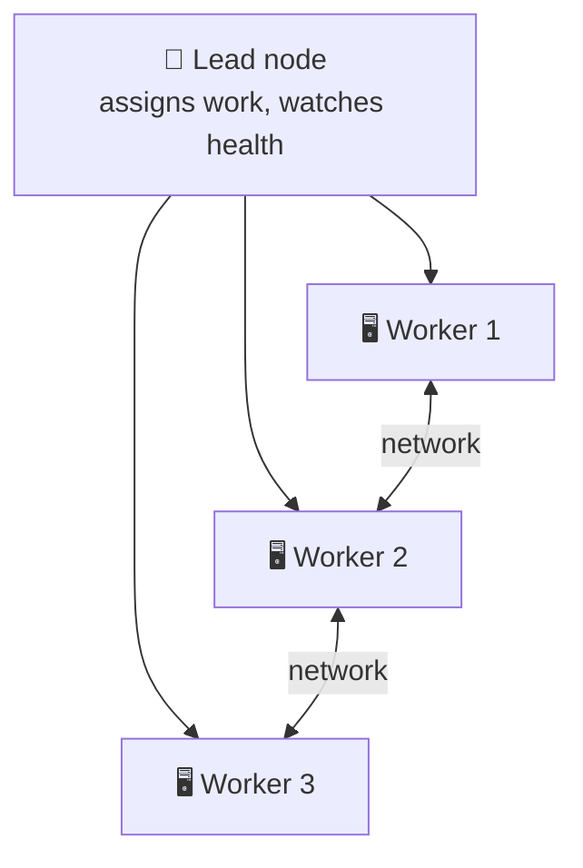
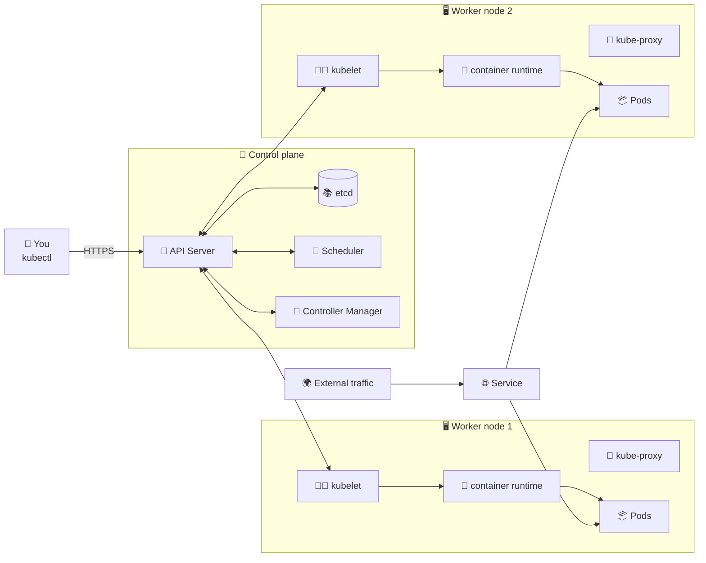
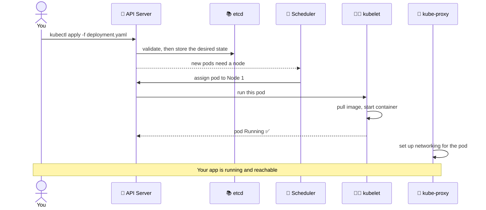
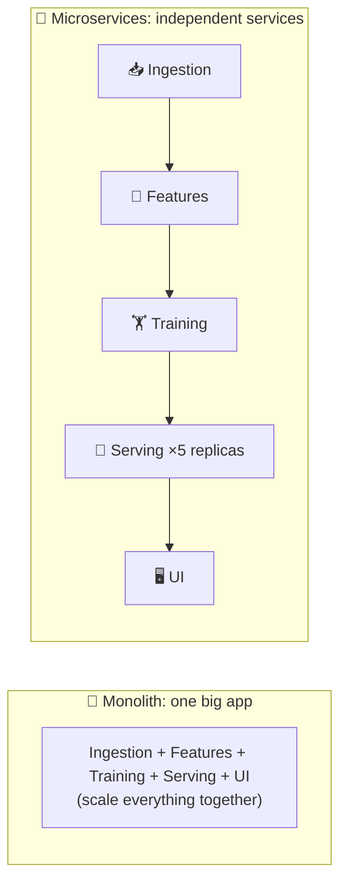
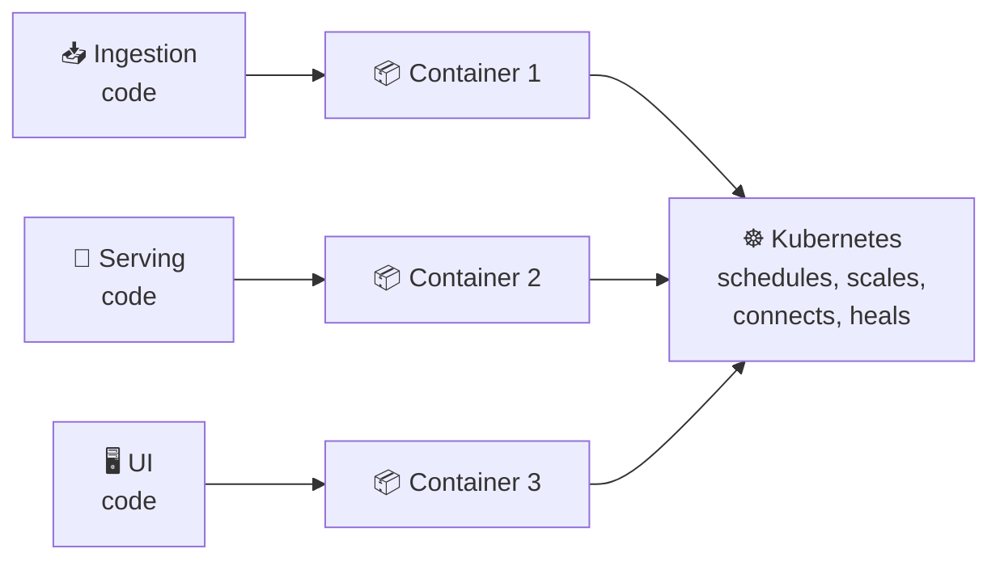

<div align="center">

# 🧠 Kubernetes Concepts and Architecture

**Why we need Kubernetes, what is inside a cluster, and how microservices fit in, explained with analogies and tied to what we built**


</div>

> 📄 Theory companion to [KUBERNETES_TUTORIAL.md](KUBERNETES_TUTORIAL.md). The practical results are in [SELF_HEALING_EXPLAINED.md](SELF_HEALING_EXPLAINED.md) and [LOAD_BALANCING_EXPLAINED.md](LOAD_BALANCING_EXPLAINED.md).
> 🏷️ Look for **✅ In our project** notes: they show where each idea appeared in the mini project.

---

## 📑 Contents

1. [Distributed computing in 2 minutes](#-1-distributed-computing-in-2-minutes)
2. [Benefits and challenges](#-2-benefits-and-challenges)
3. [Kubernetes vs Apache Spark](#-3-kubernetes-vs-apache-spark)
4. [Inside a Kubernetes cluster](#-4-inside-a-kubernetes-cluster)
5. [What happens when you run `kubectl apply`](#-5-what-happens-when-you-run-kubectl-apply)
6. [Reading `kubectl get pods -A`](#-6-reading-kubectl-get-pods--a)
7. [Common Kubernetes resources](#-7-common-kubernetes-resources)
8. [Microservices: the real-world scenario](#-8-microservices-the-real-world-scenario)
9. [Docker and Kubernetes together](#-9-docker-and-kubernetes-together)
10. [When Kubernetes makes sense (and when it doesn't)](#-10-when-kubernetes-makes-sense-and-when-it-doesnt)
11. [Summary](#-11-summary)

---

## 🌐 1. Distributed computing in 2 minutes

**Distributed computing** means many computers (nodes) work together on one large problem. The work is split up, and the nodes run in parallel, so the job finishes faster and keeps going if some nodes fail.



| Component | Plain meaning | Analogy |
|-----------|---------------|---------|
| 🧩 **Cluster** | A group of connected computers working as one system. Each computer is a **node**. | A kitchen team |
| 👑 **Lead node** (master) | Manages the cluster: assigns work, monitors health | The head chef |
| 📡 **Communication** | Nodes exchange data and instructions over the network | Orders called across the kitchen |
| ⚡ **Concurrency** | Many tasks run at once. If a node fails, its work moves to others | Another cook takes over a dish |

> ✅ **In our project:** Minikube is a one-node cluster. It has a control plane (the lead) and a worker role on the same machine. Our 2 pods are the tasks being shared.

---

## ⚖️ 2. Benefits and challenges

### 🎁 Benefits

| Benefit | What it means | Example |
|---------|---------------|---------|
| 📈 **Scalability** | Split the work across many machines | An ML training job that takes 10 hours on 1 machine can take much less on 10 |
| 🛡️ **Fault tolerance** | If one machine fails, others take over | A power grid: one station goes offline, others cover it |
| 🚀 **Performance** | Tasks run in parallel, so lower waiting time | A web app serves more users by running on several servers |
| 💰 **Cost efficiency** | Several cheaper machines instead of one expensive one | Commodity servers instead of one giant machine |
| 🔀 **Flexibility** | Mix machine types, even cloud providers | Add GPU nodes only when needed |

### 🧗 Challenges, and how Kubernetes answers each one

| ⚠️ Challenge | 🛠️ Kubernetes answer | ✅ Seen in our project |
|-------------|---------------------|-----------------------|
| **Resource management**: who gets how much CPU and memory? | The **scheduler** places pods on nodes with room, and **resource limits** cap usage | `memory: 64Mi`, `cpu: 200m` in [deployment.yaml](deployment.yaml) |
| **Scaling**: adding or removing machines is hard work | Change one number: `replicas`. Kubernetes adds or removes pods | `replicas: 2` |
| **Networking**: nodes must talk reliably | Built-in pod networking, plus Services as stable addresses | Service port 8080 → 5000 |
| **Fault handling**: detect failures and recover | **Self-healing**: a controller replaces failed pods | [Deleted a pod, a new one appeared](SELF_HEALING_EXPLAINED.md) |
| **Load balancing**: spread work evenly | A Service shares traffic across healthy pods | [Both pods served requests](LOAD_BALANCING_EXPLAINED.md) |
| **Configuration and deployment**: managing hundreds of machines by hand is a nightmare | **Declarative YAML**: describe the goal once, Kubernetes makes it so | One `kubectl apply -f deployment.yaml` |
| **Monitoring and debugging**: logs are scattered | Central tools: `kubectl logs`, the dashboard, Prometheus, ELK | `kubectl logs -f <pod>`, `minikube dashboard` |

> 🍽️ **Analogy: a restaurant chain**
> **Without Kubernetes**, you manage chefs, waiters, supplies and orders at every branch by hand. If one branch runs out of ingredients or a waiter quits, things fall apart.
> **With Kubernetes**, a central system watches every branch, restocks automatically, brings in temporary staff when someone quits, and sends customers to the least crowded branch.

---

## 🔥 3. Kubernetes vs Apache Spark

Both help with distributed computing, but they solve different problems.

| | **Apache Spark** | **Kubernetes** |
|---|------------------|----------------|
| **What it is** | A distributed **computation engine** for big data | A general-purpose **container orchestrator** |
| **Computation model** | Splits data work into steps (map, shuffle, reduce, and more) and runs them in parallel | **None.** It doesn't care what your container computes |
| **Typical job** | Crunch a huge dataset | Keep apps running, scaled and healthy |
| **Together?** | ✅ Yes. Spark can **run on** Kubernetes, which supplies the machines | |

> 💡 **Note on MapReduce:** *MapReduce* (map = process, reduce = aggregate) is the classic model from Hadoop. Spark builds on the same idea but runs its steps in memory as a graph of tasks, which is usually faster. Kubernetes has no built-in model like this.

---

## 🏗️ 4. Inside a Kubernetes cluster

A cluster has two halves: the **control plane** (the brain) and **worker nodes** (the muscle).



### 🧠 Control plane

| Component | Job | Analogy |
|-----------|-----|---------|
| 🚪 **API Server** | The single entry point. Validates requests and talks to every other component. `kubectl` talks to it. | The receptionist: every request goes through them |
| 📚 **etcd** | Distributed key-value database. Stores the cluster's desired and current state. | A library catalogue, updated on every change |
| 📅 **Scheduler** | Picks which node should run each new pod, based on free resources and rules | A dispatcher giving the job to the most available worker |
| 🔁 **Controller Manager** | Runs control loops (Deployment, ReplicaSet, Node controllers). If reality differs from the goal, it fixes it, e.g. creates a new pod when one dies. | A backup generator: always keeps the count right |

### 🖥️ Worker nodes

| Component | Job | Analogy |
|-----------|-----|---------|
| 🧑‍✈️ **kubelet** | Agent on every node. Makes sure the pods assigned to it are running and reports status | A shift supervisor |
| 🚦 **kube-proxy** | Sets up the network rules on the node so traffic to a Service reaches a pod (using iptables or IPVS) | A traffic cop at the intersection |
| 🐳 **Container runtime** | Pulls images and actually starts containers (containerd, CRI-O, Docker) | The machine on the factory floor |
| 📦 **Pod** | The smallest deployable unit. Wraps one or more containers that share network and storage | A container ship carrying the goods |

> 📝 **Terminology:** older material says *master node*. The current name is **control plane**. There's no separate "resource manager": the **scheduler** places pods, and the **kubelet** enforces their resource limits on each node.

> ☁️ **Managed Kubernetes:** with EKS, AKS or GKE the cloud provider runs the control plane for you. You manage the apps and worker nodes.

---

## 🎬 5. What happens when you run `kubectl apply`



| # | Step |
|:-:|------|
| 1️⃣ | You run a `kubectl` command |
| 2️⃣ | The request goes to the **API Server** |
| 3️⃣ | The API Server validates it and stores the desired state in **etcd** |
| 4️⃣ | The **Scheduler** finds a suitable node for each pod |
| 5️⃣ | The **kubelet** on that node pulls the image and starts the container |
| 6️⃣ | **kube-proxy** sets up networking so the pod can be reached |

> ✅ **In our project:** this is exactly what `kubectl apply -f deployment.yaml` did. Because we set `imagePullPolicy: Never`, step 5 used the image we loaded with `minikube image load`.

---

## 🖥️ 6. Reading `kubectl get pods -A`

`-A` means *all namespaces*, so you also see Kubernetes' own system pods.

```text
NAMESPACE              NAME                                   READY   STATUS    RESTARTS   AGE
kube-system            coredns-559f6c778d-hq5wm               1/1     Running   0          14m
kube-system            etcd-minikube                          1/1     Running   0          14m
...
```

### Columns

| Column | Meaning |
|--------|---------|
| **NAMESPACE** | The group the pod belongs to |
| **NAME** | Usually the app name plus a unique suffix |
| **READY** | Ready containers / total containers (`1/1` = all ready) |
| **STATUS** | `Running`, `Pending`, `Completed`, `Error`, and so on |
| **RESTARTS** | How many times its containers restarted |
| **AGE** | Time since creation |

### What each system pod does (from our Minikube cluster)

| Pod | Role | Category |
|-----|------|----------|
| `coredns-…` | Cluster DNS: pods find each other by name | 🌐 DNS |
| `etcd-minikube` | Stores cluster state and configuration | 🧠 Control plane |
| `kube-apiserver-minikube` | Front door; receives all API requests | 🧠 Control plane |
| `kube-controller-manager-minikube` | Keeps the actual state matching the desired state | 🧠 Control plane |
| `kube-scheduler-minikube` | Chooses where new pods run | 🧠 Control plane |
| `kube-proxy-…` | Service networking and traffic routing on the node | 🔌 Networking |
| `kindnet-…` | Pod networking (a CNI plugin) | 🔌 Networking |
| `storage-provisioner` | Creates storage volumes on demand in Minikube | 💾 Storage |
| `kubernetes-dashboard-…` | Web UI for the cluster | 📊 Dashboard |
| `dashboard-metrics-scraper-…` | Collects metrics for the dashboard | 📊 Dashboard |

**What the output tells you:** the local cluster is healthy. Control plane, networking, DNS, storage and dashboard are all `1/1 Running` with `0` restarts.

**Useful follow-ups**

```bash
kubectl get pods -n kube-system                     # only the system pods
kubectl describe pod <pod-name> -n <namespace>      # detailed info about a pod
kubectl logs <pod-name> -n <namespace>              # a pod's logs
```

---

## 📚 7. Common Kubernetes resources

| Resource | What it does | In our project? |
|----------|--------------|:---------------:|
| **Pod** | Runs one or more containers | ✅ |
| **ReplicaSet** | Keeps a set number of identical pods running (our backup generator) | ✅ |
| **Deployment** | Manages ReplicaSets and rolling updates | ✅ |
| **Service** | Stable network address for a set of pods (a restaurant hotline: whoever picks up, your order is taken) | ✅ |
| **Namespace** | A virtual cluster inside a cluster (HR, Sales and IT share a building but have their own floors) | ✅ `default` and `kube-system` |
| **Volume / PersistentVolume** | Storage that pods can use and share | ⬜ not yet |
| **ConfigMap** | Non-secret configuration | ⬜ not yet |
| **Secret** | Sensitive data (passwords, keys) | ⬜ not yet |
| **Ingress** | HTTP/HTTPS routing from outside to Services | ⬜ not yet |
| **Manifest (YAML)** | The blueprint Kubernetes reads to know what to build | ✅ [deployment.yaml](deployment.yaml) |

---

## 🎬 8. Microservices: the real-world scenario

Imagine an ML system that recommends movies to users, like Netflix. It has five parts:

| # | Component | Job |
|:-:|-----------|-----|
| 1 | 📥 **Data Ingestion** | Collects user data (watch history, ratings) |
| 2 | 🧪 **Feature Engineering** | Turns raw data into model inputs |
| 3 | 🏋️ **Model Training** | Retrains the recommendation model regularly |
| 4 | 🔮 **Model Serving** | Hosts the model and answers "what should User123 watch?" |
| 5 | 🖥️ **User Interface** | The website or app users see |

### 🧱 Monolith vs 🧩 microservices



| | 🧱 Monolith | 🧩 Microservices |
|---|-------------|-----------------|
| **Scaling** | Scale the whole app, even if only serving is busy | Scale **only** Model Serving |
| **Failure** | One bug can take everything down | If Training crashes, the others keep running |
| **Tech choice** | One language and stack | Each service picks its own (Python + TensorFlow for serving, JavaScript + React for the UI) |
| **Updates** | Redeploy everything | Update one service independently |

> 🍔 **Analogy: a food court.** Each stall specialises in one cuisine and works independently. If one runs out of ingredients, the others are unaffected. Customers choose what they like, and the **food court manager (Kubernetes)** makes sure every stall has electricity and water.

> ✅ **In our project:** the Flask app is a miniature "serving service". Scaling it to 2 replicas and testing it is exactly what you would do for the Model Serving Service in this scenario. See the ML example in [REAL_WORLD_KUBERNETES.md](REAL_WORLD_KUBERNETES.md) (local copy).

---

## 🐳 9. Docker and Kubernetes together



| Tool | Role | Analogy |
|------|------|---------|
| 🐳 **Docker** | Packages each service with all its dependencies. Lightweight, portable, runs the same on a laptop, a server or the cloud | **Takeout boxes**: everything the dish needs is inside |
| ☸️ **Kubernetes** | Runs and manages those containers | **The food court manager** |

**What Kubernetes adds on top of the containers**

1. 📈 **Scaling:** a long line at the burger stall? Add more burger chefs (replicas).
2. 🔌 **Networking:** customers can find every stall, and stalls can reach each other.
3. ⚖️ **Load balancing:** traffic is shared across the copies of a service.

**Advantages for ML systems**

| ✅ Advantage | Meaning |
|-------------|---------|
| **Independent scaling** | Spike in users? Scale only Model Serving, not Training |
| **Resilience** | A crashed service doesn't stop the others |
| **Flexibility** | Different languages and tools per service |

---

## 🎯 10. When Kubernetes makes sense (and when it doesn't)

| ✅ It makes sense when… | ⚠️ It may be too much when… |
|------------------------|----------------------------|
| You run microservices or many services | The app is simple or the team is tiny |
| You need scaling and resilience | You have little capacity to operate it |
| Teams run containerised apps in production | A lighter tool is enough |

| 👍 Strengths | 👎 Challenges |
|-------------|--------------|
| Scales apps more easily | Steep learning curve |
| Portable across environments and clouds | Setup and operation can be complex |
| High availability and self-healing | Needs monitoring and maintenance |
| Manages many containers consistently | Debugging can be difficult |

**Typical use cases:** web applications, microservices, batch processing, machine-learning workloads, CI/CD pipelines, scalable back-end systems.

---

## 🧾 11. Summary

| | |
|---|---|
| 🌐 **Distributed computing** | Gives scalability, fault tolerance, speed, cost efficiency and flexibility |
| 🧗 **Its challenges** | Resource management, scaling, networking, fault handling, load balancing, deployment, monitoring |
| ☸️ **Kubernetes** | Automates and simplifies those challenges, and is the backbone of modern MLOps |
| 🧩 **Microservices** | Break a system into small services that deploy, scale and fail independently |
| 🐳 **Docker + Kubernetes** | Docker packages each service, and Kubernetes runs, connects, scales and heals them |

<div align="center">

**Docker packs it. Kubernetes runs it. Microservices let it grow.** 🚀

</div>

---

<details>
<summary>🖼️ Local-only visual references (kept in <code>images/</code>, not pushed to GitHub)</summary>

| File | What it shows | Matches section |
|------|---------------|-----------------|
| `images/Kubernetes Architecture Infographic_dark.png` | Dark infographic: components, request flow, resources, use cases | [4](#-4-inside-a-kubernetes-cluster), [5](#-5-what-happens-when-you-run-kubectl-apply), [7](#-7-common-kubernetes-resources) |
| `images/Kubernetes Architecture Visual Guide_white.png` | Light infographic: cluster overview, benefits and challenges, when it fits | [4](#-4-inside-a-kubernetes-cluster), [10](#-10-when-kubernetes-makes-sense-and-when-it-doesnt) |
| `images/Kubernetes Pod Command Explained_infographic.png` | Annotated breakdown of our `kubectl get pods -A` output | [6](#-6-reading-kubectl-get-pods--a) |

</details>
