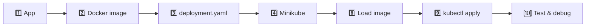

<div align="center">

# ☸️ Kubernetes Tutorial: Project Flow

**From a Docker image to a running, self-healing app on Minikube**


[📺 Original tutorial](https://github.com/vikashishere/YT-K8S-Mini-Project/tree/main#kubernetes-tutorial-projectflow) · [🩹 Self-healing demo](SELF_HEALING_EXPLAINED.md)

</div>

---

## 🗺️ Workflow at a glance



## 📋 Prerequisites

| | Tool | Notes |
|:-:|------|-------|
| 🐳 | **Docker Desktop** | Installed and running |
| 🔑 | **Docker Hub** | Signed in |
| ☸️ | **Minikube** | Install in [Step 4](#-4-install-minikube) |

## 📑 Contents

| # | Step | # | Step |
|:-:|------|:-:|------|
| 1 | [Build the app](#-1-build-the-application) | 8 | [Load image](#-8-load-docker-image-to-minikube) |
| 2 | [Docker image](#-2-prepare-and-build-the-docker-image) | 9 | [Apply deployment](#-9-apply-deployment) |
| 3 | [Deployment YAML](#-3-create-the-deployment-yaml-file) | 10 | [Test the app](#-10-test-the-application) |
| 4 | [Install Minikube](#-4-install-minikube) | 11 | [Debugging & logs](#-11-debugging-and-logs) |
| 5 | [Troubleshooting](#-5-troubleshooting-minikube) | 12 | [Load testing](#-12-load-testing-with-postman) |
| 6 | [Verify status](#-6-verify-minikube-status) | 13 | [Stop Minikube](#-13-stop-minikube) |
| 7 | [Add nodes](#-7-adding-nodes) | 14 | [ImagePullBackOff](#-14-handling-imagepullbackoff-issue) |

---

## 🛠️ Steps

### 🧱 1. Build the Application

1. Create or use an existing application.
2. Test it locally to make sure it works as expected.

---

### 🐳 2. Prepare and Build the Docker Image

1. Create a `Dockerfile` in your project directory.
2. Build the image:

   ```bash
   docker build -t k8s-test-app:latest .
   ```

3. Verify the image:

   ```bash
   docker images
   ```

4. Test it locally:

   ```bash
   docker run -p 5000:5000 k8s-test-app:latest
   ```

---

### 📝 3. Create the Deployment YAML File

Define a Kubernetes Deployment in a file named `deployment.yaml`.

<details>
<summary><b>✨ Generate the YAML with the VS Code Kubernetes extension</b></summary>

1. Install the extension:
   - Open VS Code → **Extensions** (`Ctrl+Shift+X`).
   - Search **Kubernetes** (Microsoft, `ms-kubernetes-tools.vscode-kubernetes-tools`) → **Install**.
   - Optional: also install the **YAML** extension (Red Hat) for validation and highlighting.
2. Create a new file (e.g. `test.yaml` or `deployment.yaml`).
3. Type `deployment` in the empty file. A snippet list appears.
4. Select **Kubernetes Deployment** (`Enter` or `Tab`).
5. VS Code inserts the skeleton:

   ```yaml
   apiVersion: apps/v1
   kind: Deployment
   metadata:
     name: myapp
   spec:
     selector:
       matchLabels:
         app: myapp
     template:
       metadata:
         labels:
           app: myapp
       spec:
         containers:
         - name: myapp
           image: <Image>
           resources:
             limits:
               memory: "128Mi"
               cpu: "500m"
           ports:
           - containerPort: <Port>
   ```

6. Replace the placeholders (`Tab` jumps between them):

   | Placeholder | Value |
   |-------------|-------|
   | `name` / `app` | `kubernetes-test-app` |
   | `<Image>` | `k8s-test-app:latest` (or `<your-dockerhub-username>/k8s-test-app:latest`) |
   | `<Port>` | `5000` |

7. Save, then apply it in [Step 9](#-9-apply-deployment).

</details>

> 💡 **Tip:** the same approach works for `service`, `configmap`, `ingress`, etc. Type the name and pick the matching Kubernetes snippet.

---

### 📦 4. Install Minikube

1. Visit the [Minikube Installation Guide](https://minikube.sigs.k8s.io/docs/start/?arch=%2Fwindows%2Fx86-64%2Fstable%2F.exe+download).
2. Download the `.exe` and run the install from PowerShell **as administrator**.
3. Restart your terminal. A reboot may be required.

Start Minikube:

```bash
minikube start
# or
minikube start --embed-certs
```

---

### 🚑 5. Troubleshooting Minikube

> ❌ **Common error**
>
> ```text
> Failing to connect to https://registry.k8s.io/ from both inside the minikube container and host machine
> To pull new external images, you may need to configure a proxy: https://minikube.sigs.k8s.io/docs/reference/networking/proxy/
> ```

**Solutions** (try in order):

1. **Using a proxy?** Configure it for Minikube:

   ```bash
   minikube start --docker-env HTTP_PROXY=http://your-proxy:port --docker-env HTTPS_PROXY=https://your-proxy:port
   ```

2. **No proxy?** Unset these variables:

   ```bash
   unset HTTP_PROXY
   unset HTTPS_PROXY
   unset NO_PROXY
   ```

3. **Test connectivity** to `registry.k8s.io`:

   ```bash
   nslookup registry.k8s.io
   ```

   <details>
   <summary>Example output</summary>

   ```text
   Server:  dlinkrouter.local
   Address:  192.168.0.1

   Non-authoritative answer:
   Name:    registry.k8s.io
   Addresses:  2600:1901:0:bbc4::
             34.96.108.209
   ```

   </details>

4. **Clean up and restart:**

   ```bash
   minikube stop
   minikube delete --all
   ```

---

### ✅ 6. Verify Minikube Status

```bash
minikube status
```

Verify Kubernetes resources:

```bash
kubectl get all -A
kubectl get pods -A
kubectl get nodes -A
```

---

### ➕ 7. Adding Nodes

```bash
minikube start --nodes=2
# or
minikube start --nodes=2 --embed-certs
```

---

### 📥 8. Load Docker Image to Minikube

1. Verify the images:

   ```bash
   minikube image list
   docker images
   ```

2. Load the image into Minikube:

   ```bash
   minikube image load k8s-test-app:latest
   ```

> ⚠️ The `image:` in `deployment.yaml` must match the name you load here, otherwise the pod fails with `ErrImageNeverPull`.

---

### 🚀 9. Apply Deployment

```bash
kubectl apply -f deployment.yaml
```

Delete it if needed:

```bash
kubectl delete deployment kubernetes-test-app
```

---

### 🧪 10. Test the Application

1. Check pods and nodes:

   ```bash
   kubectl get pods -A
   kubectl get nodes -A
   ```

2. *(Optional)* Delete a pod and watch Kubernetes recreate it. See [🩹 Self-healing explained](SELF_HEALING_EXPLAINED.md):

   ```bash
   kubectl delete pod <pod-name/id>
   ```

3. Open the app:

   ```bash
   minikube service kubernetes-test-app
   ```

4. Open the dashboard:

   ```bash
   minikube dashboard
   ```

---

### 🐞 11. Debugging and Logs

| Goal | Command |
|------|---------|
| Stream pod logs | `kubectl logs -f <pod-id>` |
| List endpoints | `kubectl get endpoints` |
| List services | `kubectl get service` |

---

### 📈 12. Load Testing with Postman

Use Postman for performance tests:

- Go to **Collection → Runs → Performance → Run Performance Test**.
- Example: fixed profile, **10 users for 1 minute**.
- Why we do this and what it proves: [⚖️ Load balancing explained](LOAD_BALANCING_EXPLAINED.md).

---

### 🛑 13. Stop Minikube

```bash
minikube stop
```

---

### 🧯 14. Handling ImagePullBackOff Issue

If you hit `ImagePullBackOff`:

1. Tag the image with your Docker Hub username:

   ```bash
   docker tag k8s-test-app:latest <your-dockerhub-username>/k8s-test-app:latest
   ```

2. Push it to Docker Hub:

   ```bash
   docker push <your-dockerhub-username>/k8s-test-app:latest
   ```

3. Point `image:` in `deployment.yaml` to the pushed name.

---

<div align="center">

🎉 **Done!** Your app is running on Kubernetes.

</div>
