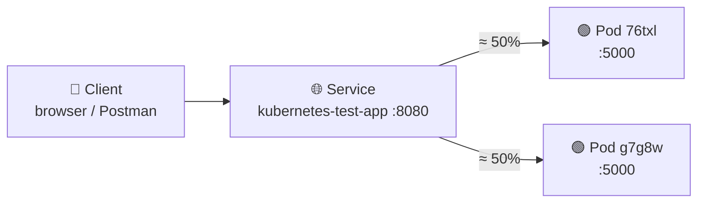

<div align="center">

# ⚖️ Load Balancing in Kubernetes

**Two pods, one address: how traffic gets shared, and how we proved it**


</div>

> 📄 Part of the same project as [KUBERNETES_TUTORIAL.md](KUBERNETES_TUTORIAL.md) and [SELF_HEALING_EXPLAINED.md](SELF_HEALING_EXPLAINED.md). Config comes from [deployment.yaml](deployment.yaml).

---

## 📑 Contents

1. [The idea](#-1-the-idea)
2. [How Kubernetes does it](#-2-how-kubernetes-does-it)
3. [How we got there](#-3-how-we-got-there)
4. [Proof 1: pod logs](#-4-proof-1-pod-logs)
5. [Proof 2: Postman load test](#-5-proof-2-postman-load-test)
6. [How this helps real applications](#-6-how-this-helps-real-applications)
7. [What we learned](#-7-what-we-learned)

---

## 💡 1. The idea

Running 2 replicas only helps if requests are **spread across them**. Otherwise one pod does all the work while the other sits idle, and you get no extra capacity and no extra safety.

Kubernetes solves this with a **Service**: one stable address in front of many pods. Clients talk to the Service, and the Service picks a pod.

| Without a Service | With a Service |
|-------------------|----------------|
| Pods have changing IPs (new pod = new IP) | One stable name and IP |
| Client must know every pod | Client knows only the Service |
| Dead pod = broken requests | Dead pod is removed from rotation |

---

## ⚙️ 2. How Kubernetes does it

From [deployment.yaml](deployment.yaml):

```yaml
kind: Service
metadata:
  name: kubernetes-test-app
spec:
  selector:
    app: kubernetes-test-app   # 👈 "send traffic to pods with this label"
  ports:
  - port: 8080                 # Service port
    targetPort: 5000           # Flask port inside the pod
```



**Step by step**

1. The Service's `selector` matches pods by **label**, not by name.
2. Kubernetes keeps a live list of matching, *Ready* pods (the **endpoints**). Check it with `kubectl get endpoints`.
3. `kube-proxy` on the node routes each new connection to one of those endpoints.
4. A pod that dies, or isn't Ready, is dropped from the list automatically. A replacement joins it automatically (see [self-healing](SELF_HEALING_EXPLAINED.md)).

> ⚠️ **Not strict round-robin.** In the default mode, `kube-proxy` picks backends roughly at random, so the split is *about* even over many requests, not alternating one by one.
> It balances per **connection**. A client that reuses one connection keeps hitting the same pod.

---

## 🧭 3. How we got there

| Step | What we did | Why |
|:----:|-------------|-----|
| 1 | Set `replicas: 2` in the Deployment | We need more than one pod to balance across |
| 2 | Added a Service with a label selector | One address in front of both pods |
| 3 | Opened it with `minikube service kubernetes-test-app` | Minikube exposes the Service on a local URL (`127.0.0.1:<port>`) |
| 4 | Clicked around in the browser, then ran `kubectl logs -f <pod>` for **each** pod | To see which pod served which request |
| 5 | Ran a Postman **Fixed** load test: **10 virtual users, 2 minutes** | A browser sends a handful of requests. A load test sends thousands, so any imbalance would show |
| 6 | Watched the pod logs *during* the test | To confirm both pods were busy at the same time |

---

## 🔬 4. Proof 1: pod logs

Two terminals, one `kubectl logs -f` per pod, while using the app in the browser:


**What to look for**

- Left: pod `g7g8w`. Right: pod `76txl`. Each shows its **own** requests (`GET /` → 200, `POST /` → 302).
- Neither pod has all of the traffic. The Service is sharing it.
- Pod IPs differ (`10.244.0.5` and `10.244.0.4`), which confirms these are two separate pods.
- Every request shows source `10.244.0.1`. That's the node/tunnel address, not the real client. Traffic coming through Minikube's tunnel is NATed, so the app can't see the real client IP.

---

## 📈 5. Proof 2: Postman load test

**Setup:** *Collection → Runs → Performance → Run Performance Test*, **Fixed** profile, **10 VUs**, **2 minutes**, `GET /` against the Service URL.

While it ran, both pods' logs scrolled with `GET / 200` at the same moment:


**Result (read from Postman during the run)**

| Metric | Value | Meaning |
|--------|------:|---------|
| Total requests | 25,250 | Requests sent so far |
| Throughput | 229 req/s | Requests per second |
| Avg response | 24 ms | Typical latency |
| P90 / P95 / P99 | 84 / 90 / 102 ms | 90% / 95% / 99% of requests were faster than this |
| Error % | 38.44 | ⚠️ See note below |

> ⚠️ **Honest note.** The error rate jumped to ~100% about 70 seconds in, and Postman showed a *"system resources are constrained"* warning. The pods kept returning `200` in their logs at that time and never crashed, which points at the **client or the Minikube tunnel** as the limit, not the app. We did not investigate further, so treat the throughput and latency figures as indicative only.

**Reading the results**

- **Percentiles beat averages.** P99 = 102 ms means 1 in 100 users waited longer than that. Averages hide those outliers.
- **Both pods busy at once** is the load-balancing proof. The logs show it directly.
- **What we are really measuring on Minikube:** laptop CPU, Docker Desktop, the tunnel and Postman. Numbers are for *comparison*, not for production sizing.

---

## 🌍 6. How this helps real applications

| Benefit | How load balancing delivers it |
|---------|-------------------------------|
| 📈 **Scale out** | More replicas means more requests per second. `kubectl scale ... --replicas=3` and no client changes. |
| 🛡️ **High availability** | If one pod dies, the Service stops sending it traffic. Users keep being served by the others. |
| 🔄 **Zero-downtime updates** | During a rolling update, old and new pods run side by side. The Service routes only to Ready ones. |
| 🧩 **Decoupling** | Clients use a stable name (`kubernetes-test-app`). Pods can come and go freely. |
| 🔍 **Observability** | Per-pod logs and the dashboard show how load is distributed. |

---

## 🎓 7. What we learned

1. **Replicas + Service = scaling and resilience.** Replicas alone just give you more pods. The Service makes them act as one app.
2. **Labels are the glue.** The Service finds pods by label, which is why replacement pods join automatically.
3. **Balancing is approximate and per connection**, not a strict turn-taking.
4. **Test, don't assume.** Per-pod logs plus a load test prove the traffic is shared.
5. **Know what you're measuring.** On Minikube the test client and tunnel can be the bottleneck. Read errors carefully before blaming the app.
6. **The app has limits we set.** The pods have `64Mi` memory and `200m` CPU limits, and Flask's built-in dev server is not meant for production load.

**🔜 Next steps:** re-run at 5 and 10 VUs to find where the errors start, delete a pod *during* the test to combine this with self-healing, and try a Horizontal Pod Autoscaler (HPA) to add replicas automatically under load.

<div align="center">

**One address, many pods, shared load.** ⚖️

</div>
