<div align="center">

# ☸️ Kubernetes Mini Project

**A small Flask web app, packaged with Docker and run on Kubernetes (Minikube), with self-healing and load balancing tested hands-on.**


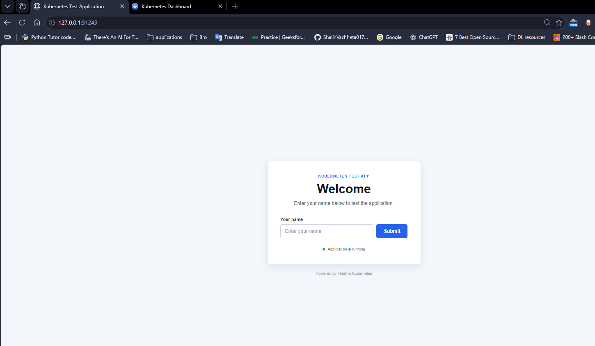

</div>

---

## 👋 In one minute

I built a simple web app and ran it the way real production apps run: **in containers, managed by Kubernetes**.
Then I tried to break it, to see what Kubernetes does about it.

| 🧪 What I tested | ✅ What happened |
|-----------------|------------------|
| Deleted a running pod | Kubernetes created a new one by itself. The app stayed up. → [Self-healing](SELF_HEALING_EXPLAINED.md) |
| Sent lots of traffic to the app | Requests were shared between both pods. → [Load balancing](LOAD_BALANCING_EXPLAINED.md) |
| Ran it from scratch on a clean cluster | A full step-by-step guide that works end to end. → [Tutorial](KUBERNETES_TUTORIAL.md) |

## 🎯 Skills shown

- 🐳 **Containerising** an app with a `Dockerfile` (small image, cached layers)
- ☸️ **Kubernetes basics:** Deployments, ReplicaSets, Services, labels, resource limits
- 🩹 **Reliability:** self-healing and replicas
- ⚖️ **Load balancing and load testing** with Postman
- 🐞 **Debugging:** pod logs, endpoints, the Kubernetes dashboard, common errors (`ImagePullBackOff`, proxy issues)

---

## 🏗️ How it fits together

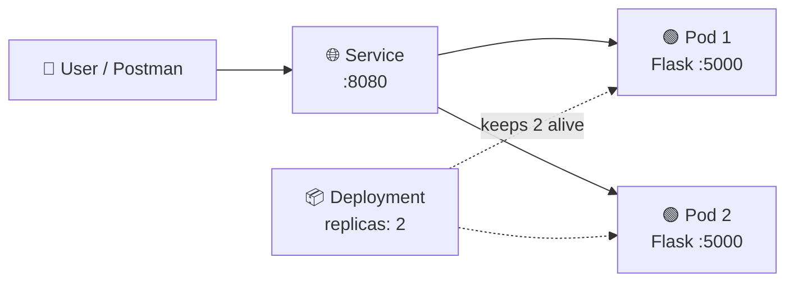

- **Deployment** says "always run 2 copies of the app".
- **Service** gives one stable address and shares traffic between the copies.
- If a pod dies, the Deployment replaces it, and the Service starts using the new one automatically.

---

## 🚀 Run it yourself

**You need:** Docker Desktop, [Minikube](https://minikube.sigs.k8s.io/docs/start/) and `kubectl`.

```bash
# 1. Build the image
docker build -t k8s-test-app:latest .

# 2. Start a local cluster and give it the image
minikube start
minikube image load k8s-test-app:latest

# 3. Deploy
kubectl apply -f deployment.yaml
kubectl get pods

# 4. Open the app in your browser
minikube service kubernetes-test-app
```

<details>
<summary>▶️ Just want to run the app without Kubernetes?</summary>

```bash
pip install -r requirements.txt
python app.py        # open http://localhost:5000
```

</details>

---

## 📸 Results

<table>
  <tr>
    <td align="center" width="50%">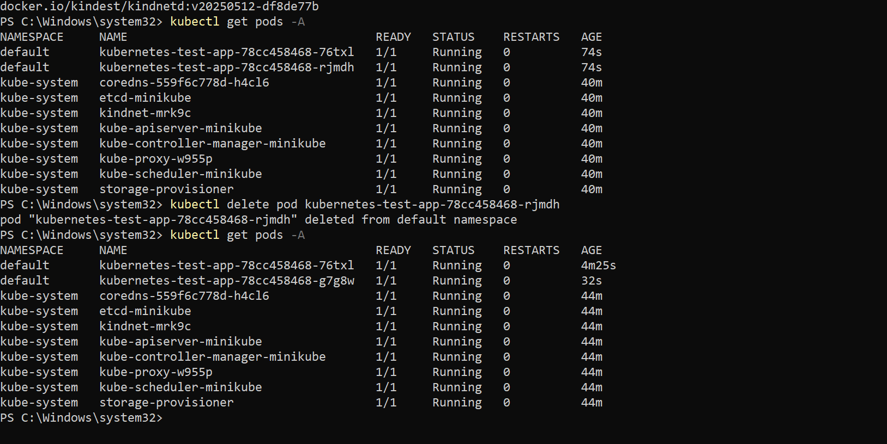<br><b>🩹 Self-healing:</b> deleted pod, new pod appears</td>
    <td align="center" width="50%">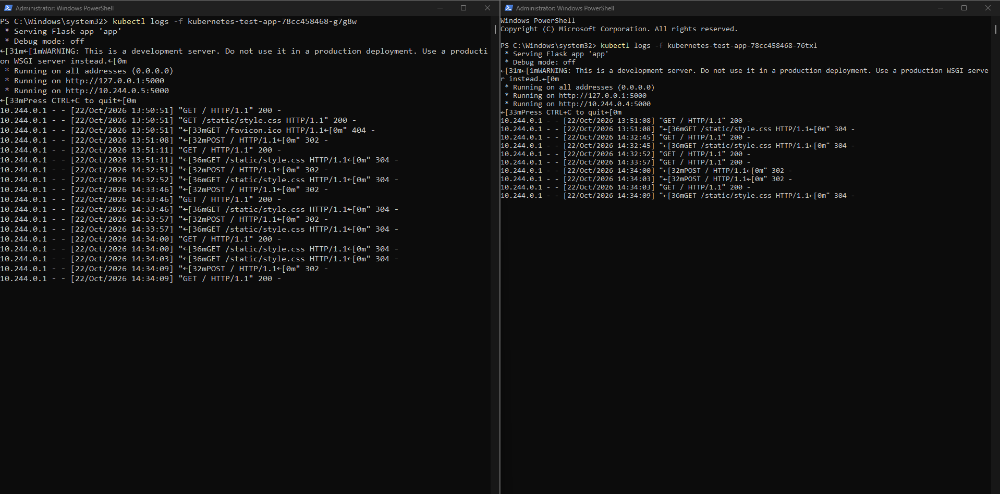<br><b>⚖️ Load balancing:</b> both pods serve requests</td>
  </tr>
  <tr>
    <td align="center">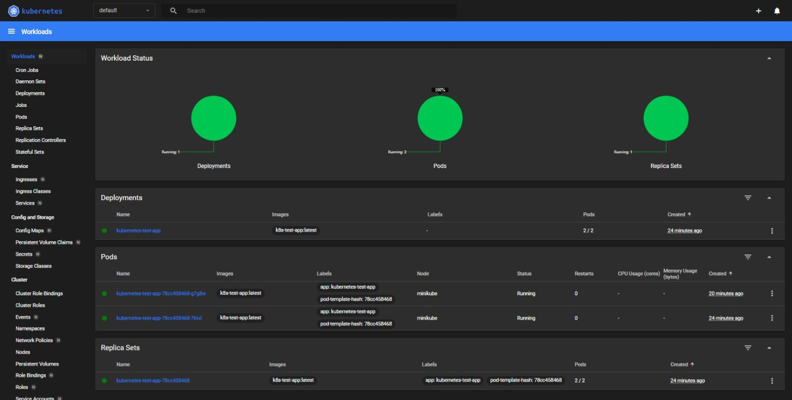<br><b>📊 Dashboard:</b> 2/2 pods running</td>
    <td align="center">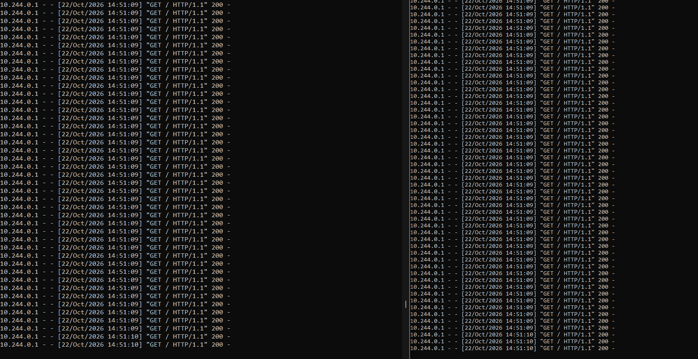<br><b>📈 Load test:</b> both pods busy at once</td>
  </tr>
</table>

<details>
<summary>🖼️ More screenshots (setup)</summary>

| Docker image | Containers |
|:------------:|:----------:|
| 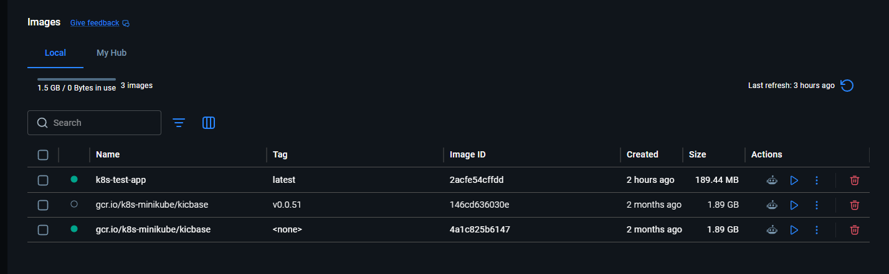 | 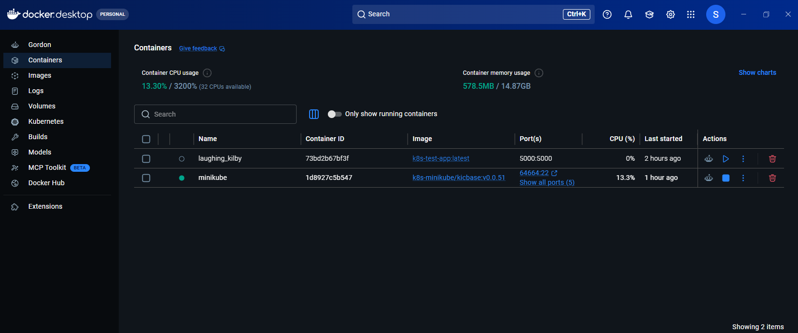 |

| Cluster pods | Minikube status and images | Image load |
|:------------:|:--------------------------:|:----------:|
| 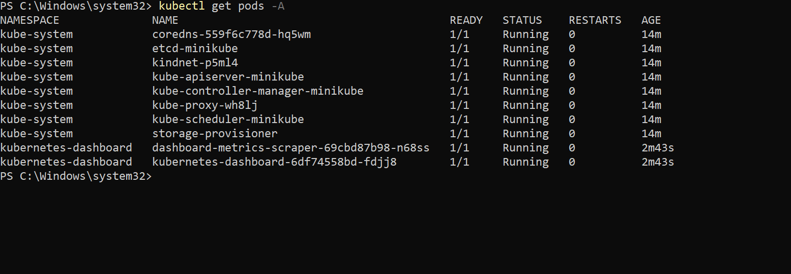 | 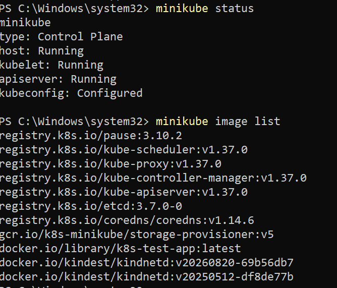 | 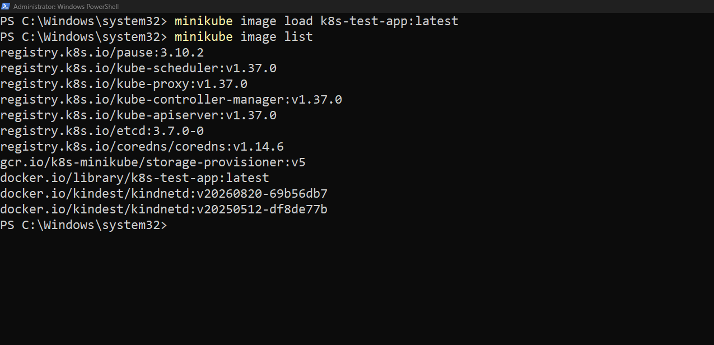 |

</details>

---

## 📚 Learn more (written in plain language)

| 📄 Guide | What it covers |
|----------|----------------|
| [KUBERNETES_TUTORIAL.md](KUBERNETES_TUTORIAL.md) | The full 14-step walkthrough, with troubleshooting |
| [SELF_HEALING_EXPLAINED.md](SELF_HEALING_EXPLAINED.md) | What happens when a pod is deleted, and why |
| [LOAD_BALANCING_EXPLAINED.md](LOAD_BALANCING_EXPLAINED.md) | How traffic is shared, how I tested it, what it means |

## 🗂️ Project structure

```text
.
├── app.py                         # Flask app (home page with a name form)
├── templates/index.html           # Page HTML
├── static/style.css               # Page styling
├── requirements.txt               # Python dependencies
├── dockerfile                     # How the container image is built
├── deployment.yaml                # Kubernetes Deployment (2 replicas) + Service
├── images/                        # Screenshots used in the docs
└── *.md                           # Tutorial and explanations
```

## 🧠 What I learned

1. **Declare the goal, Kubernetes does the work.** I said "2 replicas" and it kept that true, even when I deleted a pod.
2. **Labels connect everything.** The Service finds pods by label, which is why replacements join automatically.
3. **Load balancing is approximate.** Traffic is shared roughly evenly, per connection, not turn by turn.
4. **Read errors carefully.** In my load test the errors appeared while the pods kept answering. The limit looked like my laptop, Postman or the Minikube tunnel, not the app.
5. **Names must match.** The image name in `deployment.yaml` must match the image loaded into Minikube, or the pod won't start.

## 🔜 Next steps

- Add a Horizontal Pod Autoscaler to add pods under load
- Replace Flask's dev server with `gunicorn` for production use
- Push the image to Docker Hub and deploy to a real cloud cluster
- Add health checks (readiness and liveness probes)

---

<div align="center">

Built by **Shalin Vachheta** · MLOps learning project

</div>
