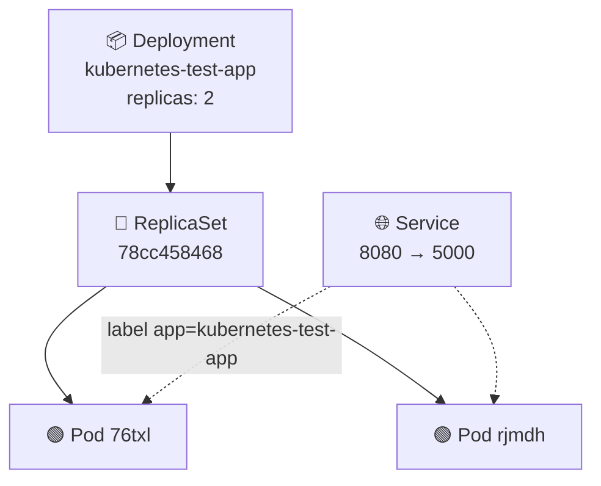
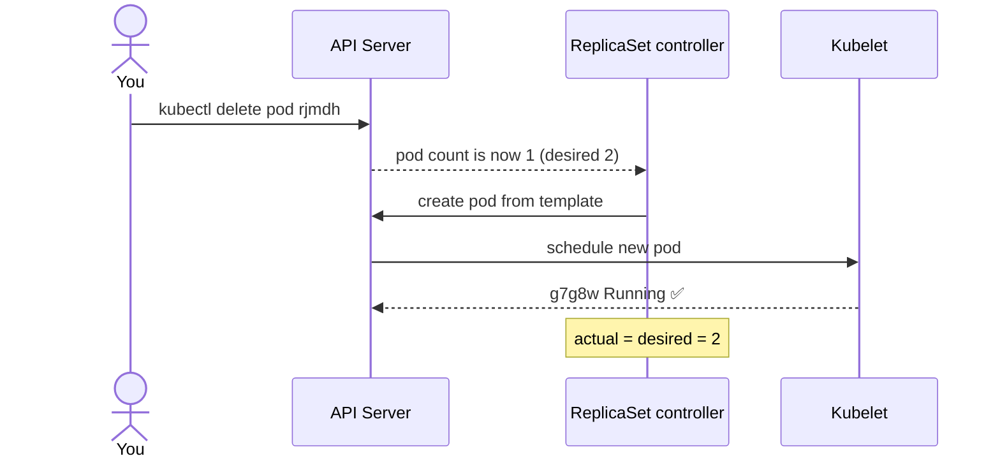

<div align="center">

# 🩹 Kubernetes Self-Healing in Action

**What happens when you delete a pod from a Deployment?**


</div>

> 📄 Based on [deployment.yaml](deployment.yaml) and the terminal output from the experiment.

---

## 📑 Contents

1. [The declared state](#-1-the-declared-state)
2. [What the terminal showed](#-2-what-the-terminal-showed)
3. [Why a new pod appeared](#-3-why-a-new-pod-appeared)
4. [Key observations](#-4-key-observations)
5. [Try it yourself](#-5-try-it-yourself)

---

## 🎯 1. The declared state

```yaml
kind: Deployment
metadata:
  name: kubernetes-test-app
spec:
  replicas: 2              # 👈 desired state: always 2 pods
  selector:
    matchLabels:
      app: kubernetes-test-app
```

The Deployment never creates pods directly. It owns a **ReplicaSet**, which keeps the number of pods labelled `app: kubernetes-test-app` equal to `replicas`.



> 💡 **Reading a pod name:** `kubernetes-test-app` – `78cc458468` – `76txl`
> = *Deployment* – *ReplicaSet hash* – *random pod suffix*

---

## 🖥️ 2. What the terminal showed

| # | Command | Result |
|:-:|---------|--------|
| 1️⃣ | `kubectl get pods -A` | 2 app pods in `default` (`76txl`, `rjmdh`), both `1/1 Running`, age **74s**. Other rows are Minikube system pods in `kube-system` (40m). |
| 2️⃣ | `kubectl delete pod kubernetes-test-app-78cc458468-rjmdh` | ❌ Pod `rjmdh` deleted. |
| 3️⃣ | `kubectl get pods -A` | Still **2** app pods: old `76txl` (4m25s) + a **new** `g7g8w` (32s). `rjmdh` is gone. |

### Before → After

| | Pod | Status | Age | |
|---|-----|:------:|:---:|---|
| Before | `76txl` | ✅ Running | 74s | untouched |
| Before | `rjmdh` | ✅ Running | 74s | 🗑️ deleted |
| After | `76txl` | ✅ Running | 4m25s | same pod, kept running |
| After | `g7g8w` | ✅ Running | 32s | 🆕 created by Kubernetes |

---

## 🔄 3. Why a new pod appeared



| Step | State |
|:----:|-------|
| 1 | **Desired:** 2 replicas · **Actual after delete:** 1 |
| 2 | ReplicaSet controller detects the mismatch |
| 3 | Creates a pod from the Deployment template (same image, labels, limits) with a new random name |
| 4 | Back to 2 running pods, with no manual action |

This is Kubernetes' **declarative reconciliation loop**: you declare what you want, and controllers keep reality matching it.

---

## 🔍 4. Key observations

| 🔎 Observation | 💬 Why it matters |
|----------------|------------------|
| New pod, **not a restart** | New name, new age, `RESTARTS 0`. Pods are disposable: *cattle, not pets*. |
| Same ReplicaSet hash `78cc458468` | No new rollout. The template didn't change, so the ReplicaSet just added a pod. |
| `76txl` was never touched | No downtime. The Service kept routing to it during recovery. |
| Service finds pods by **label** | The new pod carries `app: kubernetes-test-app`, so it joined the Service automatically. |
| `imagePullPolicy: Never` | The image is already loaded in Minikube, so startup is fast. Nothing is pulled from a registry. |
| Different ages (4m25s vs 32s) | Time passed between the first and second listing. |

> ⚠️ **Not the same thing:** `kubectl delete -f deployment.yaml` removes the Deployment *and* its ReplicaSet, so pods are **not** recreated.

---

## 🧪 5. Try it yourself

```powershell
# Terminal 1: watch live
kubectl get pods -w

# Terminal 2: break something
kubectl delete pod <pod-name>

# Change the desired state
kubectl scale deployment kubernetes-test-app --replicas=3
```

<div align="center">

**Declare it once. Kubernetes keeps it true.** ✨

</div>
